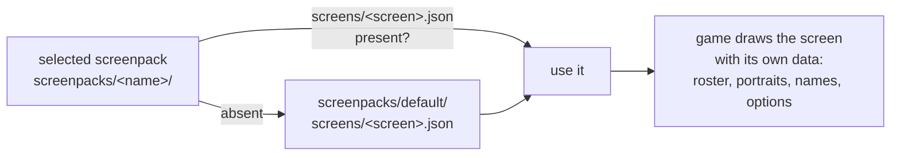
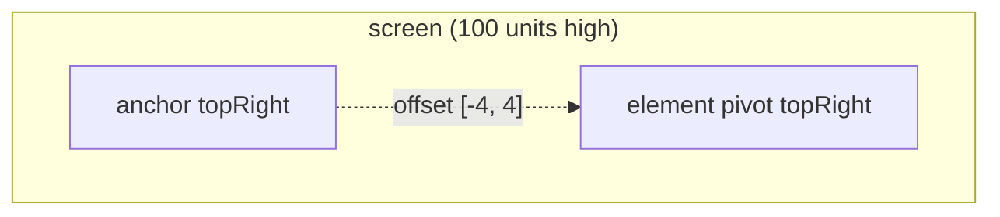

# Screenpack format

A **screenpack** gives the game its look: the screens around the fights (title, menus, character and stage select, VS, options, pause, results…), their layout, art, animations, text styles, music and sounds. It is OpenKakutou's own format (roadmap decision `029`), not MUGEN's or Ikemen GO's `system.def`/`select.def`, which are neither read nor converted.

A screenpack describes **appearance only**. It cannot add behavior: no scripting, no new menu actions, no settings. What a menu offers comes from the game and from the installed modes (decision `030`); a screenpack only orders, hides and styles those entries. Lifebars are not part of a screenpack: they live in `lifebars/`, in the MUGEN/Ikemen GO format (decision `031`).

Format version: **1**.

Related roadmap decisions: [`029`](https://github.com/openkakutou/roadmap/blob/main/.vibe/decisions/029-openkakutou-screenpack-format-and-complete-game-layer.md) (format, settings, discovery), [`030`](https://github.com/openkakutou/roadmap/blob/main/.vibe/decisions/030-one-game-runtime-modes-as-data.md) (one runtime, modes as data), [`031`](https://github.com/openkakutou/roadmap/blob/main/.vibe/decisions/031-game-install-folder-layout.md) (installed folder layout), [`034`](https://github.com/openkakutou/roadmap/blob/main/.vibe/decisions/034-no-content-sidecar-order-in-screenpack-visibility-in-mode.md) (roster order from the screenpack).

## How the game finds a screen



The diagram shows the per-screen fallback: each screen comes whole from the selected screenpack, or whole from `default` when the selected one does not have it. Screens are never merged element by element.

## Folder

```
screenpacks/
└── neon/                     one folder per screenpack; the folder name is its id
    ├── screenpack.json       root file: identity and defaults
    ├── screens/              one file per screen, all optional
    │   ├── title.json
    │   ├── characterSelect.json
    │   └── …
    ├── images/               PNG or WebP, plus their sprite-sheet descriptions (.json)
    ├── sounds/               OGG (Vorbis or Opus)
    └── fonts/                TTF, OTF or WOFF2
```

Only `screenpack.json` is required. The `images/`, `sounds/` and `fonts/` folder names are a convention, not a rule: assets are found through the paths the files give.

## Syntax

Every file is **JSONC**: JSON with `//` and `/* */` comments and trailing commas allowed, UTF-8. Each file kind has a published JSON Schema (backlog item 002); a file may name it in `$schema` for editor completion. Unknown fields are refused, so a typo is reported instead of silently ignored.

**Paths** are relative to the screenpack folder, written with `/`, and stay inside it: no absolute path, no `..`. A referenced file that does not exist is an error.

**Assets** are standard formats only:

| Kind | Formats |
|---|---|
| Images | PNG, WebP |
| Sound and music | OGG (Vorbis or Opus) |
| Fonts | TTF, OTF, WOFF2 |

MUGEN formats (`.sff`, `.snd`, `.fnt`, `.def`) are refused inside a screenpack.

## Units and layout

A screen has no fixed pixel size: elements are placed by an **anchor** and an **offset**, so the same screenpack fits any resolution and aspect ratio.

- **Unit**: `1` unit is 1/100 of the screen height. A 16:9 screen is about 177.8 units wide and 100 tall; a 4:3 screen about 133.3 by 100. Sizes, offsets, font sizes and spacing all use this unit, so everything scales with the height.
- **`anchor`**: the point of the screen the element hangs from, one of `topLeft`, `top`, `topRight`, `left`, `center`, `right`, `bottomLeft`, `bottom`, `bottomRight`. Default `center`.
- **`pivot`**: the point of the element placed on the anchor, same values. Default: the anchor's value, so an element anchored `topLeft` sits in the corner.
- **`offset`**: `[x, y]` in units from the anchor, x to the right, y downward. Default `[0, 0]`.
- **`size`**: `[width, height]` in units. For an image, giving one of the two as `null` keeps the image's aspect ratio. Default: the image's own size at 1 image pixel = 1/240 of the screen height (the 240-line reference MUGEN screens used).
- **Draw order**: elements are drawn in the order they are listed; later ones are on top.



The diagram shows one element hung 4 units left of and below the screen's top-right corner.

## Root file: `screenpack.json`

| Field | Type | Meaning |
|---|---|---|
| `$schema` | string, optional | Schema path or URL, for editors. |
| `formatVersion` | `1` | Format version. Only `1` exists. |
| `name` | non-empty string | Name shown in the appearance options. |
| `author` | non-empty string | Author or authors. |
| `version` | non-empty string | The screenpack's own version, free text, e.g. `1.2.0`. |
| `fonts` | object | Font ids to font files: `{ "body": "fonts/Inter.woff2" }`. Screens and text styles refer to fonts by id. |
| `textStyles` | object | Named text styles (see [Text styles](#text-styles)), usable by every screen. Must include `default`. |
| `sounds` | object | Default menu sounds, used by every screen that does not set its own: `move`, `confirm`, `cancel`, `error`, each a sound path. |
| `music` | object, optional | Default music (see [Music](#music)) for screens that set none. |

## Common building blocks

### Elements

An element is one drawn thing. Every element has `type` and the layout fields above (`anchor`, `pivot`, `offset`, `size`), plus:

| Field | Type | Meaning |
|---|---|---|
| `visible` | boolean | Default `true`; `false` keeps the element out without deleting it. |
| `opacity` | number 0–1 | Default `1`. |
| `transition` | object | How it appears and leaves (see [Transitions](#transitions)). |

| `type` | Extra fields | Draws |
|---|---|---|
| `image` | `image`: an image path, or `sheet` + `animation` | A still image, or a sprite-sheet animation. |
| `text` | `text`: a fixed string, `style`: a text style id | Fixed text, e.g. a caption. Text the game supplies (names, values) is drawn by the screen's own parts, not by `text` elements. |
| `rect` | `color`, optional `radius` (units) | A filled rectangle, e.g. a panel behind a menu. |

`image` elements also take `tile`: `none` (default), `x`, `y` or `both`, repeating the image to fill `size`; and `scroll`: `[x, y]` in units per second, moving a tiled image for scrolling backgrounds.

Colors are `#rrggbb` or `#rrggbbaa` strings.

### Sprite sheets

An image path ending in `.png` or `.webp` is a single still. A **sprite sheet** is a `.json` file next to its image:

```jsonc
{
  "image": "cursor.png",            // relative to this .json file's folder
  "frames": {                        // frame id -> [x, y, width, height] in image pixels
    "c0": [0, 0, 32, 32],
    "c1": [32, 0, 32, 32]
  },
  "animations": {                    // animation id -> frames in order
    "blink": {
      "frames": [{ "frame": "c0", "ms": 300 }, { "frame": "c1", "ms": 300 }],
      "loop": true                   // default true; false holds the last frame
    }
  }
}
```

An element shows a sheet with `"sheet": "images/cursor.json", "animation": "blink"`, or one still frame with `"sheet": …, "frame": "c0"`.

### Text styles

| Field | Type | Meaning |
|---|---|---|
| `font` | font id | One of the root `fonts`. |
| `size` | number > 0 | Line height in units. |
| `color` | color | Fill color. |
| `align` | `left`, `center`, `right` | Alignment against the element's position. Default `left`. |
| `outline` | `{ "color", "width" }` | Optional outline, width in units. |
| `shadow` | `{ "color", "offset": [x, y] }` | Optional drop shadow, offset in units. |
| `uppercase` | boolean | Default `false`. |

A screen may add its own `textStyles`; a screen's style overrides a root style of the same id for that screen.

### Transitions

A `transition` on a screen or an element: `{ "in": <effect>, "out": <effect> }`, each effect `{ "kind", "ms", "easing", "delayMs", "from" }`:

- `kind`: `none`, `fade`, `slide` or `scale`.
- `ms`: duration in milliseconds.
- `easing`: `linear`, `easeIn`, `easeOut` or `easeInOut`. Default `easeOut`.
- `delayMs`: wait before starting, default `0`; staggering delays makes elements arrive one after the other.
- `from`: for `slide`, the side the element comes from (`left`, `right`, `top`, `bottom`); for `scale`, the starting scale (number).

A transition only changes how a screen enters and leaves; it never delays an input the game accepts.

### Menus

Screens with a menu give it a `menu` part. The game decides the **entries** (from its built-in screens and the installed modes); the screenpack only styles and arranges them.

| Field | Type | Meaning |
|---|---|---|
| layout fields | | Where the menu sits; the first entry is at the pivot. |
| `direction` | `vertical`, `horizontal` | Default `vertical`. |
| `spacing` | number | Distance between entries, in units. |
| `visibleEntries` | integer ≥ 1, optional | Entries shown at once; the menu scrolls beyond. Default: all. |
| `style`, `activeStyle`, `disabledStyle` | text style ids | Entry text, the entry under the cursor, an entry the game greys out. |
| `cursor` | element | Drawn behind the active entry (an `image` or `rect`), moving with it. |
| `order` | array of entry ids | Entries listed first, in this order; entries not listed follow in the game's order. Unknown ids are ignored, so a screenpack keeps working when the game's entries change. |
| `hidden` | array of entry ids | Entries not shown. An entry the game requires to leave the screen (`back`, `continue` on pause) cannot be hidden. |
| `sounds` | `{ move, confirm, cancel, error }` | Overrides the root sounds for this menu. |

Labels come from the game, translated into the player's language; a screenpack does not rename entries.

### Music

`{ "file": "sounds/title.ogg", "volume": 0.8, "loopStartMs": 4200 }`: `volume` 0–1 (default 1) is multiplied by the player's music volume setting; the music loops from `loopStartMs` (default 0). `"music": null` on a screen means silence; leaving `music` out keeps whatever is playing when the previous screen used the same file, otherwise the root music.

## Screen files

Every screen file has these common fields, then the parts specific to its screen:

| Field | Type | Meaning |
|---|---|---|
| `$schema` | string, optional | For editors. |
| `formatVersion` | `1` | Format version. |
| `background` | array of elements | Drawn first, behind everything. |
| `foreground` | array of elements | Drawn last, above the screen's parts. |
| `music` | music, or `null` | See [Music](#music). |
| `sounds` | `{ move, confirm, cancel, error }` | Overrides the root sounds for the whole screen. |
| `textStyles` | object | Screen-local text styles. |
| `transition` | transition | How the whole screen enters and leaves. |

A **part** is a named area the game fills with its own data: the screenpack places and styles it, the game decides its content. Each part takes the layout fields plus the fields listed below. A part left out of a screen file takes the default screenpack's layout for that part; screen files are still never merged otherwise.

The screen file names match `game`'s built-in screen types (game#032) and its mode format.

### `title.json` — title and main menu

| Part | Fields | The game fills it with |
|---|---|---|
| `logo` | `image` element | — (the screenpack's art) |
| `menu` | [menu](#menus) | The installed modes, then `options`, `exit` (native only). |
| `pressStart` | `text` (style), `blinkMs` | "Press start" before the menu opens; `blinkMs` 0 = steady. |
| `version` | `style` | The game version. |

### `characterSelect.json` — character select

| Part | Fields | The game fills it with |
|---|---|---|
| `grid` | `columns`, `rows`, `cellSize` [w, h], `spacing` [x, y], `cell` (element behind each cell), `emptyCell` (element for an unused cell), `random` (element for the random cell) | One cell per selectable character, showing its small portrait. Scrolls when the roster exceeds `columns × rows`. |
| `sort` | `by`: `folder`, `displayName` or `author`; `descending`: boolean | The roster order (decision `034`). Default `folder`, ascending. Always case-insensitive. |
| `cursor` | `p1`, `p2`: elements, `both`: element when the two cursors share a cell | Each side's cursor. |
| `portrait` | `p1`, `p2`: layout, `mirrorP2`: boolean (default true) | The hovered character's large portrait, from the character's own sprites. |
| `name` | `p1`, `p2`: `style` + layout | The hovered character's display name, from its `.def`. |
| `palette` | `p1`, `p2`: `style` + layout | The chosen palette number, while choosing it. |
| `title` | `style` + layout | The screen title ("Player 1", "Select your fighter"…), from the game. |
| `sounds` | `confirmP1`, `confirmP2`, `random` | Extra sounds for this screen. |

### `stageSelect.json` — stage select

| Part | Fields | The game fills it with |
|---|---|---|
| `sort` | as `characterSelect` | The stage list order. |
| `preview` | layout | A preview of the hovered stage, drawn from the stage itself. |
| `name` | `style` + layout | The stage name, from its `.def`. |
| `arrows` | `left`, `right`: elements | Shown when more stages exist on that side. |
| `title` | `style` + layout | The screen title. |

### `matchSetup.json` — match setup

| Part | Fields | The game fills it with |
|---|---|---|
| `menu` | [menu](#menus), plus `valueStyle` | One entry per open rule (rounds, time limit, player 2 control) with its current value. |
| `title` | `style` + layout | The screen title. |

### `versus.json` — VS screen

| Part | Fields | The game fills it with |
|---|---|---|
| `portrait` | `p1`, `p2`: layout, `mirrorP2` | Both fighters' large portraits. |
| `name` | `p1`, `p2`: `style` + layout | Both names. |
| `stage` | `style` + layout | The stage name. |
| `durationMs` | integer ≥ 0 | How long the screen stays before the match; a confirm press skips it. Default `3000`. |

### `options.json` — options

| Part | Fields | The game fills it with |
|---|---|---|
| `tabs` | [menu](#menus) (usually `horizontal`) | The option pages: `gameplay`, `audio`, `video`, `controls`, `appearance`. |
| `menu` | [menu](#menus), plus `valueStyle`, `valueOffset` [x, y] | The current page's settings and their values. |
| `controls` | `slotStyle`, `waitingStyle` + layout | On the `controls` page: each action and its bound key or button; `waitingStyle` while waiting for a press. |
| `hint` | `style` + layout | A one-line help for the selected setting. |
| `title` | `style` + layout | The screen title. |

Option values are settings (`gameplay.json`, `audio.json`, `video.json`, `controls.json`, decision `029`); a screenpack never holds or changes them.

### `pause.json` — pause

| Part | Fields | The game fills it with |
|---|---|---|
| `dim` | `color` | Drawn over the frozen match. Default `#00000099`. |
| `title` | `style` + layout | "PAUSE". |
| `menu` | [menu](#menus) | `continue`, `restart`, `moveList`, `characterChange`, `options`, `exit`, as the game and the mode offer them. |

### `moveList.json` — move list

| Part | Fields | The game fills it with |
|---|---|---|
| `title` | `style` + layout | The character's name. |
| `list` | `style`, `visibleLines`, `lineSpacing` + layout | The character's moves, from its own files. |
| `buttons` | `sheet` + frame per button id (`up`, `down`, `forward`, `back`, `a`, `b`, `c`, `x`, `y`, `z`, `start`) | Icons replacing button names in the moves. Missing icons fall back to text. |
| `scrollbar` | `track`, `thumb`: elements | Shown when the list is longer than `visibleLines`. |

### `results.json` — results

| Part | Fields | The game fills it with |
|---|---|---|
| `winner` | `portrait` layout, `name` (`style` + layout) | The winner's portrait and name. |
| `message` | `style` + layout | "Player 1 wins", "Draw"… |
| `score` | `style` + layout | Rounds won by each side. |
| `menu` | [menu](#menus) | `rematch`, `back`, as the mode offers them. |

### `continue.json` — continue

| Part | Fields | The game fills it with |
|---|---|---|
| `portrait` | layout | The defeated player's character. |
| `countdown` | `style` + layout | The seconds left. |
| `message` | `style` + layout | "Continue?". |
| `menu` | [menu](#menus) | `yes`, `no`. |
| `sounds` | `tick`, `gameOver` | Each countdown second; the end. |

### `victory.json` — victory

| Part | Fields | The game fills it with |
|---|---|---|
| `portrait` | layout | The winning character. |
| `name` | `style` + layout | Its name. |
| `message` | `style` + layout | The victory text. |
| `durationMs` | integer ≥ 0 | How long before returning to the title; a confirm press skips. Default `8000`. |

## Example: a complete screenpack

A small screenpack that styles the title, the character select and the pause screen, and leaves every other screen to `default`.

```
screenpacks/neon/
├── screenpack.json
├── screens/
│   ├── title.json
│   ├── characterSelect.json
│   └── pause.json
├── images/  bg-grid.png  logo.webp  cursor.png  cursor.json
├── sounds/  title.ogg  move.ogg  confirm.ogg  cancel.ogg  error.ogg
└── fonts/   Orbitron.woff2  Inter.woff2
```

`screenpack.json`:

```jsonc
{
  "$schema": "https://openkakutou.github.io/screenpack/schema/v1/screenpack.schema.json",
  "formatVersion": 1,
  "name": "Neon",
  "author": "Jane Doe",
  "version": "1.0.0",
  "fonts": {
    "display": "fonts/Orbitron.woff2",
    "body": "fonts/Inter.woff2"
  },
  "textStyles": {
    "default": { "font": "body", "size": 4, "color": "#e8e8ff" },
    "heading": { "font": "display", "size": 7, "color": "#ff3cac", "align": "center",
                 "shadow": { "color": "#00000099", "offset": [0.4, 0.4] }, "uppercase": true },
    "entry":   { "font": "display", "size": 5, "color": "#9a9ac8", "align": "center" },
    "active":  { "font": "display", "size": 5, "color": "#ffffff", "align": "center",
                 "outline": { "color": "#ff3cac", "width": 0.3 } }
  },
  "sounds": {
    "move": "sounds/move.ogg",
    "confirm": "sounds/confirm.ogg",
    "cancel": "sounds/cancel.ogg",
    "error": "sounds/error.ogg"
  }
}
```

`screens/title.json`:

```jsonc
{
  "formatVersion": 1,
  "music": { "file": "sounds/title.ogg", "volume": 0.8, "loopStartMs": 4200 },
  "background": [
    { "type": "rect", "anchor": "topLeft", "size": [400, 100], "color": "#0b0820" },
    { "type": "image", "image": "images/bg-grid.png", "anchor": "bottom",
      "size": [400, 50], "tile": "x", "scroll": [-6, 0], "opacity": 0.6 }
  ],
  "transition": { "in": { "kind": "fade", "ms": 400 }, "out": { "kind": "fade", "ms": 250 } },
  "logo": { "type": "image", "image": "images/logo.webp", "anchor": "top",
            "offset": [0, 12], "size": [90, null],
            "transition": { "in": { "kind": "scale", "from": 0.6, "ms": 500 } } },
  "pressStart": { "style": "heading", "text": "Press start", "anchor": "bottom",
                  "offset": [0, -18], "blinkMs": 600 },
  "menu": {
    "anchor": "center", "offset": [0, 12], "spacing": 7,
    "style": "entry", "activeStyle": "active",
    "cursor": { "type": "rect", "size": [60, 6], "color": "#ff3cac33", "radius": 1 },
    "order": ["versus", "training", "options"],
    "hidden": ["watch"]
  },
  "version": { "style": "default", "anchor": "bottomRight", "offset": [-2, -2] }
}
```

`screens/characterSelect.json`:

```jsonc
{
  "formatVersion": 1,
  "background": [
    { "type": "rect", "anchor": "topLeft", "size": [400, 100], "color": "#0b0820" }
  ],
  "title": { "style": "heading", "anchor": "top", "offset": [0, 4] },
  "grid": {
    "anchor": "bottom", "offset": [0, -6],
    "columns": 8, "rows": 3, "cellSize": [10, 10], "spacing": [1, 1],
    "cell": { "type": "rect", "color": "#1d1840" },
    "emptyCell": { "type": "rect", "color": "#120f2a" },
    "random": { "type": "text", "text": "?", "style": "active" }
  },
  "sort": { "by": "displayName" },
  "cursor": {
    "p1": { "type": "image", "sheet": "images/cursor.json", "animation": "blink" },
    "p2": { "type": "image", "sheet": "images/cursor.json", "animation": "blink", "opacity": 0.8 },
    "both": { "type": "rect", "color": "#ffffff55" }
  },
  "portrait": {
    "p1": { "anchor": "left", "offset": [4, -8], "size": [null, 50] },
    "p2": { "anchor": "right", "offset": [-4, -8], "size": [null, 50] }
  },
  "name": {
    "p1": { "style": "heading", "anchor": "left", "pivot": "left", "offset": [4, 20] },
    "p2": { "style": "heading", "anchor": "right", "pivot": "right", "offset": [-4, 20] }
  }
}
```

`screens/pause.json`:

```jsonc
{
  "formatVersion": 1,
  "music": null,
  "dim": { "color": "#0b0820cc" },
  "title": { "style": "heading", "anchor": "center", "offset": [0, -20] },
  "menu": {
    "anchor": "center", "spacing": 6,
    "style": "entry", "activeStyle": "active",
    "order": ["continue", "moveList", "restart"]
  }
}
```

`images/cursor.json` is the sprite sheet shown under [Sprite sheets](#sprite-sheets).

## Validation

A screenpack is refused, with an error naming the file, the field as a JSON path and the reason, when:

- a file is not valid JSONC, or breaks its schema (missing required field, unknown field, wrong type or value);
- `formatVersion` is not `1`;
- a path is absolute, leaves the screenpack folder, or names a missing file;
- an asset is not in an allowed format;
- a font id, text style id, sprite-sheet frame or animation id is not defined;
- a file in `screens/` is not a known screen name.

Unknown menu entry ids in `order` or `hidden` are **not** errors (see [Menus](#menus)). The game reports a refused screenpack and falls back to `default`.
